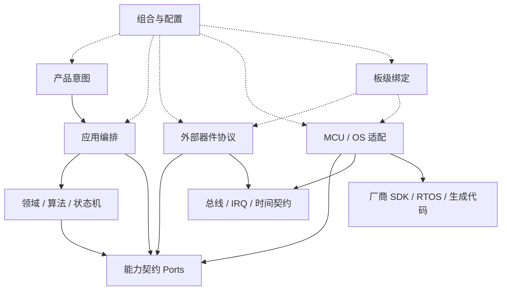

# 通用嵌入式参考架构

本文件只组织语义角色及其关系。判断依据见[架构原则](architecture_principles_zh.md)，强制边界见[依赖规则与门禁](dependency_rules_and_gates_zh.md)，角色定义见[语义层级模型](semantic_layer_model_zh.md)，落地步骤见[架构方法](architecture_methods_zh.md)，模式定义见[模式目录](architecture_patterns_zh.md)。

## 逻辑视图



箭头表示源码依赖；虚线表示组装关系。运行时调用可以从产品侧走到环境实现，但稳定代码只依赖 Port。这通常组合 [PAT-002](architecture_patterns_zh.md#PAT-002)、[PAT-006](architecture_patterns_zh.md#PAT-006) 和 [PAT-007](architecture_patterns_zh.md#PAT-007) 落地。

## 角色装配表

| 语义角色 | 主要连接 | 典型变化轴 |
|---|---|---|
| [SL-001](semantic_layer_model_zh.md#SL-001) | 调用应用用例 | 产品型号、客户流程 |
| [SL-002](semantic_layer_model_zh.md#SL-002) | 编排领域能力和 Port | 用例顺序、事务边界 |
| [SL-003](semantic_layer_model_zh.md#SL-003) | 依赖稳定 Port | 算法、状态机、协议语义 |
| [SL-004](semantic_layer_model_zh.md#SL-004) | 连接使用者与实现者 | 稳定能力语义 |
| [SL-005](semantic_layer_model_zh.md#SL-005) | 实现设备 Port，消费传输 Port | 外部器件型号/协议 |
| [SL-006](semantic_layer_model_zh.md#SL-006) | 绑定器件与平台实例 | 板卡、引脚、地址、供电 |
| [SL-007](semantic_layer_model_zh.md#SL-007) | 实现外设/中断能力 | MCU、SoC、SDK |
| [SL-008](semantic_layer_model_zh.md#SL-008) | 实现调度/同步/时间能力 | OS、并发模型 |
| [SL-009](semantic_layer_model_zh.md#SL-009) | 由 Port/Adapter 隔离后使用 | 第三方库和集成方式 |
| [SL-010](semantic_layer_model_zh.md#SL-010) | 只被环境侧依赖 | 厂商版本和生成器 |
| [SL-011](semantic_layer_model_zh.md#SL-011) | 选择、创建、注入并启动全部实例 | 产品/板卡/平台组合 |

## 外部器件链路

以任意 I2C/SPI 传感器为例，应区分四类知识：

```text
设备服务：产品需要的测量、校准、健康语义
器件协议：寄存器、命令、状态、初始化和诊断
板级绑定：总线实例、地址、片选、IRQ、复位和电源
MCU/OS 机制：控制器、DMA、中断、锁、时间和厂商 API
```

高层器件对象组合低层 I/O 能力是合理的运行时关系，但器件协议通过传输 Port 使用能力，不直接持有厂商 I2C/SPI 句柄。固定项目可以把文件放在一起，仍应保持这四类知识的边界。

## 物理目录只是映射

下面是语义组件清单，不是强制目录名：

```text
product-intent
application-orchestration
domain-algorithm
capability-contracts
external-device-protocols
board-bindings
mcu-os-adapters
composition-and-config
external-code
```

实际工程可以叫 `Core`、`Device`、`BSP`、`Drivers`、`Platform`、`Server` 或厂商自带名称，但必须维护“实际路径/构建目标 -> 语义角色”的映射。同一厂商目录含多个角色时，应在模块或构建目标粒度映射，不能整目录一刀切。

## 配置与变体

配置分为构建、板级、产品和运行时四个变化域。组合根读取已验证配置并选择实现；领域侧只接收影响策略的稳定值。若整个设备族需要成组切换，可考虑 [PAT-010](architecture_patterns_zh.md#PAT-010)；若只是查询已构造对象，可考虑 [PAT-008](architecture_patterns_zh.md#PAT-008)；若资源集合固定且同构，可考虑 [PAT-021](architecture_patterns_zh.md#PAT-021)。

## 三个同步视图

依据 [AP-008](architecture_principles_zh.md#AP-008) 和 [DR-013](dependency_rules_and_gates_zh.md#DR-013)，每个组件必须同时出现在以下视图中：

| 视图 | 表达内容 | 典型载体 | 失败信号 |
|---|---|---|---|
| 语义视图 | 职责、角色、Port 和 owner | 角色映射、模块契约 | 仅靠目录名推断层级 |
| 构建视图 | 源文件、include 可见性、链接依赖 | 构建目标、组件图 | 所有头文件全局可见或组件未入构建 |
| 运行时视图 | 实例创建、注入、注册、线程和生命周期 | Composition Root、任务/资源表 | 初始化散落、全局查找、owner 不唯一 |

三个视图的连接键应是稳定组件 ID，而不是相似目录名。

## 启动与迁移顺序

新项目先用 [AM-009](architecture_methods_zh.md#AM-009) 归一 SDK 名称，再用 [AM-004](architecture_methods_zh.md#AM-004) 建立可校验脚手架、用 [AM-005](architecture_methods_zh.md#AM-005) 打通一个真实纵向切片，最后用 [AM-006](architecture_methods_zh.md#AM-006) 固化边界。

存量项目先用 [AM-010](architecture_methods_zh.md#AM-010) 测出泄漏基线，选择一个真实变化点，建立稳定 Port、一个现有实现 Adapter 和一个 Fake，把组装移到 Composition Root，并通过编译目标限制可见性。不要为了匹配参考目录而一次重写全部代码。
