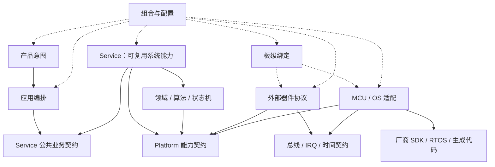

# 通用嵌入式参考架构

本文件只组织语义角色及其关系。判断依据见[架构原则](architecture_principles_zh.md)，强制边界见[依赖规则与门禁](dependency_rules_and_gates_zh.md)，角色定义见[语义层级模型](semantic_layer_model_zh.md)，落地步骤见[架构方法](architecture_methods_zh.md)，模式定义见[模式目录](architecture_patterns_zh.md)。

## 八个设计问题

架构通过以下问题控制变化，层级图只回答其中一部分。按本次范围选取，复用同一份模块契约和项目说明记录，不要求八套文档。

| 设计面 | 设计时可考虑的问题 | 可观察结果 |
|---|---|---|
| 分层 | 产品策略、领域、设备与环境为什么这样划界 | 真实职责/变化轴和角色映射 |
| 对象 | 哪些实体需要独立身份、状态、不变量与操作 | 类型、实例与协作关系；不只是结构体清单 |
| 数据 | 输入、目标、反馈、参数与快照怎样解释、流动及失效 | 单位/坐标/时间/质量/版本及唯一来源 |
| 管理 | 谁创建、连接、查找、调度、监督和销毁 | owner 与组合位置，不依赖万能全局 Manager |
| 生命周期 | 配置、初始化、复位、启动、停止与恢复各改变什么 | 前置条件、状态迁移、失败回退和在途操作取消 |
| 依赖 | 谁在源码上认识谁，运行时怎样调用 | include/类型/链接依赖与派发/回调分别描述 |
| 配置 | 哪些随构建、板卡、产品或运行参数变化 | 分域 owner、校验、生效和兼容规则；`System.h` 不成为全局杂物箱 |
| 扩展 | 下一真实变体怎样接入，哪些经验能继续使用 | 最小替换点、接入代价、资产候选与验证条件 |

具体对象推导按 [AM-012](architecture_methods_zh.md#AM-012)，工程资产积累按 [AM-013](architecture_methods_zh.md#AM-013)；边界仍以 DR-* 为准。

## 逻辑视图



箭头表示源码依赖；虚线表示组装关系。这是一种以稳定公共接口隔离实现的示意，运行时调用可以从产品侧走到环境实现。需要替换或独立验证时可参考 [PAT-002](architecture_patterns_zh.md#PAT-002)、[PAT-006](architecture_patterns_zh.md#PAT-006) 和 [PAT-007](architecture_patterns_zh.md#PAT-007)，不要求每个模块使用这些模式。

## 角色装配表

| 语义角色 | 主要连接 | 典型变化轴 |
|---|---|---|
| [SL-001](semantic_layer_model_zh.md#SL-001) | 调用应用用例 | 产品型号、客户流程 |
| [SL-002](semantic_layer_model_zh.md#SL-002) | 编排 Service 公共业务能力 | 用例顺序、事务边界 |
| [SL-003](semantic_layer_model_zh.md#SL-003) | 依赖稳定 Port | 算法、状态机、协议语义 |
| [SL-004](semantic_layer_model_zh.md#SL-004) | 连接使用者与实现者 | 稳定能力语义 |
| [SL-005](semantic_layer_model_zh.md#SL-005) | 实现设备 Port，消费传输 Port | 外部器件型号/协议 |
| [SL-006](semantic_layer_model_zh.md#SL-006) | 绑定器件与平台实例 | 板卡、引脚、地址、供电 |
| [SL-007](semantic_layer_model_zh.md#SL-007) | 实现外设/中断能力 | MCU、SoC、SDK |
| [SL-008](semantic_layer_model_zh.md#SL-008) | 实现调度/同步/时间能力 | OS、并发模型 |
| [SL-009](semantic_layer_model_zh.md#SL-009) | 按接口稳定性与依赖成本直接使用或适配 | 第三方库和集成方式 |
| [SL-010](semantic_layer_model_zh.md#SL-010) | 只被环境侧依赖 | 厂商版本和生成器 |
| [SL-011](semantic_layer_model_zh.md#SL-011) | 选择、创建、注入并启动全部实例 | 产品/板卡/平台组合 |

## App／Service／Platform／Impl／Vendor 参考组织

这是一种帮助理解职责与依赖的组织方式，不要求固定五层、目录名或逐层调用。采用此方案时可这样分工：

| 名称 | 参考职责 |
|---|---|
| App | 描述产品要做什么，组织模式、场景流程和用户交互，调用业务服务 |
| Service | 把底层能力组织成可复用的系统能力，如测量、显示、存储和电机执行 |
| Platform | 表达稳定的能力接口与对象契约，隔离具体实现知识 |
| Impl | 将契约落实到 MCU、板卡、OS 或中间件后端 |
| Vendor | 厂商 SDK、RTOS 和第三方原始底库，保持来源与业务代码边界 |

运行时可以经契约派发到实现，源码则由实现依赖契约；契约不因需要调用而包含具体实现头。回调通知也需有明确上下文与寿命，不应引入上层私有实现依赖。

其他工程可以合并或拆分这些角色。判断重点是职责、稳定接口和变化范围，而不是是否存在某一层或出现多少次函数调用。App 资产沉淀必须考虑，可保留产品流程、业务规则、状态机、数据模型和经验；Service 系统能力与适配经验也可沉淀，具体适用范围随产品与平台而定。

## 外部器件链路

以任意 I2C/SPI 传感器为例，应区分四类知识：

```text
设备服务：产品需要的测量、校准、健康语义
器件协议：寄存器、命令、状态、初始化和诊断
板级绑定：总线实例、地址、片选、IRQ、复位和电源
MCU/OS 机制：控制器、DMA、中断、锁、时间和厂商 API
```

高层器件对象可以组合低层 I/O 能力；需要跨平台复用的器件协议应通过稳定传输接口使用能力，避免绑定厂商句柄。固定项目可以把文件放在一起，是否进一步拆分取决于真实变体和维护成本。

## 采集、业务与执行的数据流

下面表示运行时数据流，不是源码 include 方向；源码依赖仍按 DR-002、APP 边界按 [DR-017](dependency_rules_and_gates_zh.md#DR-017) 判断：

```text
硬件采样/事件 -> MCU/器件适配 -> 采集服务发布测量或事件 -> APP/领域决策
APP/领域目标 -> 稳定执行命令 -> 执行服务/适配 -> PWM、GPIO、总线等硬件
                         OS/裸机运行时提供调度、时间和同步机制
```

采集服务是应用需要的测量能力，可跨器件协议与适配实现；它不意味着必须新建一个物理层。服务拥有采集状态和发布责任，缓冲区与 DMA 的 owner、交接时点和复用条件需要明确。OS 内核不会自动负责“调用 BSP 采集并把结果放进系统缓冲区”。可选择调用返回值、只读快照、有界缓冲或消息事件，依据延迟、上下文和数据寿命决定，不强制消息队列或统一缓存区。

例如姿态用例接收带单位、时间戳与有效性的测量，输出告警或姿态结果；器件寄存器格式、I2C 实例和 RTOS 队列留在服务实现侧。数据过期与采集失败由稳定错误/质量字段传递，业务模块不读取底层全局变量来猜测状态。

强实时控制可由 ISR 外壳读取一次一致的采样快照，直接调用可独立验证的控制函数，再通过静态绑定的执行接口提交目标。保持有界调用并遵守缓冲区交接契约，不必为解耦把控制环搬进任务，也不必引入动态派发。裸机与 RTOS 可以复用同一业务入口，差异留在执行外壳和组合侧。

## 对教材示例的条件化使用

- **按键**：GPIO/去抖采集、通用长短按/连击识别、产品动作是不同职责。通用手势识别可以沉淀为状态机，阈值归配置；产品动作仍由 APP 决定，不因称为“短按”就固定归某一层。
- **通信**：字节传输、外部模块命令、协议编解码、产品会话分别归属。驱动发布数据不代表接收的一段字节就是完整协议帧；边界需定义分片、长度、超时、溢出和缓冲区交接。
- **任务**：一个器件不必对应一个任务，电机也不天然要求至少两个线程。按截止时间、执行/阻塞预算和共享资源安排 ISR、DMA、事件循环与任务；多线程不能代替调度分析。
- **回调**：回调不自动切换上下文或形成隔离；声明调用位置、最大时长、可否阻塞、注册/取消与数据寿命。ISR 对 RTOS 的调用还必须遵守实际内核/端口的允许 API 与优先级规则；例如 [CMSIS-RTOS2 官方说明](https://arm-software.github.io/CMSIS_6/main/RTOS2/usingOS2.html)单独列出 ISR 可调用项及非阻塞约束。
- **性能**：不能把固定“几字节”“几条指令”“几百纳秒”当通用成本。对象/函数指针表示受目标 ABI 约束，最终代价需结合 `sizeof`、链接 map、优化后反汇编、RAM/Flash/栈与目标 WCET；[GCC 优化说明](https://gcc.gnu.org/onlinedocs/gcc/Optimize-Options.html)也明确优化受目标与选项影响。固定地址技巧不作为一般解耦方案，若使用，必须有链接、ABI、版本和可测收益的专门契约。

## 物理目录只是映射

下面是语义组件清单，不是强制目录名：

```text
product-intent
application-orchestration
domain-algorithm
capability-contracts
external-device-protocols
board-bindings
mcu-os-adapters
composition-and-config
external-code
```

实际工程可以叫 `Core`、`Device`、`BSP`、`Drivers`、`Platform`、`Server` 或厂商自带名称。先根据源码与构建事实理解职责；正式依赖审计或工具扫描需要时，再维护“实际路径/构建目标 -> 语义角色”的映射。同一目录可能含多个角色，不能按目录名一刀切；局部设计不要求先完成全库映射。

## 配置与变体

配置分为构建、板级、产品和运行时四个变化域。组合根读取已验证配置并选择实现；领域侧只接收影响策略的稳定值。若整个设备族需要成组切换，可考虑 [PAT-010](architecture_patterns_zh.md#PAT-010)；若只是查询已构造对象，可考虑 [PAT-008](architecture_patterns_zh.md#PAT-008)；若资源集合固定且同构，可考虑 [PAT-021](architecture_patterns_zh.md#PAT-021)。

## 三个同步视图

依据 [AP-008](architecture_principles_zh.md#AP-008) 和 [DR-013](dependency_rules_and_gates_zh.md#DR-013)，可从以下角度核对设计与实现的一致性。按本次问题选择相关范围，已有源码、构建配置和记录可以直接作为载体，不要求为每个组件新建三张图：

| 视图 | 表达内容 | 典型载体 | 失败信号 |
|---|---|---|---|
| 语义视图 | 职责、角色、Port 和 owner | 角色映射、模块契约 | 仅靠目录名推断层级 |
| 构建视图 | 源文件、include 可见性、链接依赖 | 构建目标、组件图 | 所有头文件全局可见或组件未入构建 |
| 运行时视图 | 实例创建、注入、注册、线程和生命周期 | Composition Root、任务/资源表 | 初始化散落、全局查找、owner 不唯一 |

需要维护正式多视图模型时，用同一组件标识关联，避免仅凭相似目录名推断一致性。

## 启动与迁移顺序

新项目先理解 SDK 职责，可参考 [AM-009](architecture_methods_zh.md#AM-009)；需要新骨架时参考 [AM-004](architecture_methods_zh.md#AM-004)，优先用 [AM-005](architecture_methods_zh.md#AM-005) 验证一个真实变化点，值得持续控制的约束再按 [AM-006](architecture_methods_zh.md#AM-006) 固化。

存量项目优先复用现有接口与实现，围绕真实变化点按 [AM-007](architecture_methods_zh.md#AM-007) 逐步调整；需要比较前后趋势时再用 [AM-010](architecture_methods_zh.md#AM-010) 建立基线。是否引入 Port、Adapter、Fake 或集中装配取决于收益，不为匹配参考目录一次重写全部代码。
