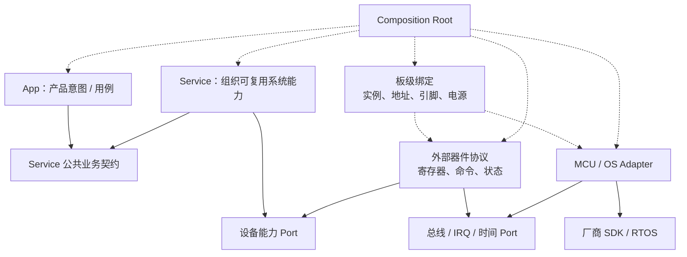

# 厂商命名无关的语义层级模型

本文件只定义“模块在架构中承担什么角色”以及如何把厂商或团队目录名归一化。判断依据来自[架构原则](architecture_principles_zh.md)；具体依赖约束在本模型之上按角色 ID 引用。目录名只是标签，层级由职责、变化原因、掌握的知识、依赖方向和资源所有权共同决定。

## 常见分层图的概念定义

APP、中间件、OS、BSP、Core、Driver 是理解工程的常见入口，不是一套跨厂商固定的六层栈。它们可以合并、拆分或旁路；OS 与中间件通常提供被多个角色使用的能力，不要求所有业务调用逐层穿过它们。层数与目录可以不同，产品策略、可复用逻辑、执行机制和硬件绑定的职责边界仍需对应。

| 常见层名 | 负责什么／典型输入输出 | 不负责什么 | 语义映射 |
|---|---|---|---|
| APP 应用层 | 只描述产品要做什么：产品模式、场景流程与用户交互；调用 Service，消费其结果/事件并发出业务请求 | 不依赖具体 HAL/驱动细节，不决定引脚、总线、DMA/IRQ 与 OS 机制 | SL-001、SL-002；底层算法/状态机交由服务或领域对象 |
| 中间件层 | 图形、协议、编解码、数学与存储等可复用能力；通过稳定 API 处理领域数据 | 板卡绑定和产品流程；依赖 OS/硬件的胶水不能冒充可移植核心 | 可复用部分为 SL-009；集成胶水另归 SL-005～SL-008 或 SL-011 |
| OS／运行时层 | 任务调度、时间、同步、队列和临界区等机制；任务/ISR 外壳在约定上下文调用业务入口 | 决定产品策略或自动成为全部采样与缓冲区的 owner | 内核为 SL-010，项目运行时适配为 SL-008；裸机由 superloop/事件循环/中断调度承担执行职责 |
| BSP／板级支持层 | 具体板卡的实例、地址、片选、引脚、供电、复位与 IRQ 绑定；连接器件与 MCU 能力 | 应用模式和业务判断；外部器件协议与板卡资源不是同一变化域 | 主要为 SL-006；厂商 BSP 混有器件协议或外设实现时分别标为 SL-005、SL-007 |
| Core／芯片支持层 | 图中此名称指启动、时钟和外设初始化等工程代码；把芯片配置变为可用资源 | 不因名为 Core 就成为可移植的算法核心 | 芯片机制为 SL-007，装配为 SL-011，生成来源另行标识；领域核心是 SL-003 |
| Driver／底层库 | MCU 控制器、寄存器与内核支持，或外部器件命令；将芯片/器件能力提供给适配层 | 不能只凭 Driver 名称推定供应商、可移植性或层级高低 | 厂商库为 SL-010，项目 MCU 机制为 SL-007，外部器件协议为 SL-005 |

代码来源与职责是两项信息：厂商/生成文件保持来源标识，不把手写业务混进去；对外独立使用的纯库可按 SL-009 分析其职责，不能因为路径属于第三方就误判为硬件适配。判定为可移植库仍需检查其实际依赖。

App/Service/Platform/Impl/Vendor 可用于表达产品意图、系统能力、契约、适配与厂商来源的不同职责；Service 负责把底层能力组织成可复用的系统能力。实际工程可以采用其他命名或合并实现，重点保持职责和依赖清楚。

## 判层的五个维度

| 维度 | 要问的问题 | 越靠产品侧 | 越靠环境侧 |
|---|---|---|---|
| 责任 | 它决定“做什么”还是“怎样访问环境” | 用例、策略、算法 | 总线、寄存器、OS 原语 |
| 变化原因 | 谁会让它变化 | 产品/协议/算法变化 | MCU/板卡/SDK/器件变化 |
| 知识 | 它必须知道什么 | 领域状态和稳定语义 | 地址、引脚、句柄、寄存器 |
| 类型暴露 | 公共接口暴露什么 | 项目稳定值对象 | 厂商句柄、RTOS/寄存器类型 |
| 所有权 | 它拥有何种状态/资源 | 业务状态和策略 | 外设、DMA、IRQ、锁、队列 |

同一运行时调用链可以跨越多个角色，但源码依赖仍应指向稳定契约。不能按“调用得更底层”简单决定层级。

## 语义角色

### SL-001 产品意图（Product Intent）

负责客户可见行为、产品模式和顶层触发条件，通过 Service 表达产品需求。它不拥有寄存器、总线实例或 RTOS 句柄。

### SL-002 应用编排（Application Orchestration）

把多个 Service 组织成产品用例，决定调用顺序和事务边界，拥有本用例的状态与恢复策略。输入输出表达产品/业务语义，通过稳定业务/领域接口协作，避免把硬件或调度细节带入产品流程。业务运行在任务或 ISR 内，不改变其角色。

### SL-003 领域／算法核心（Domain / Algorithm）

承载可脱离目标硬件验证的状态机、协议语义、算法和不变量。这里的“Core”是语义角色，不等同于任何 SDK 中名为 `Core` 的目录。

### SL-004 能力契约（Capability Contract / Port）

由使用者需要的语义定义接口，只暴露稳定项目类型，是依赖倒置的连接点。接口是否合适取决于调用者需要的语义，同一角色 ID 不自动证明职责合理。Platform 可以定义时间、总线、设备 I/O、同步等对象协议，但不选择具体实现。

### SL-005 外部器件协议（External Device Protocol）

理解板外芯片或模块的寄存器、命令、状态和器件生命周期，例如传感器、Flash、显示控制器、触摸屏。它依赖 I2C/SPI/GPIO/IRQ/时间等能力契约，不应直接依赖某个 MCU 的外设句柄。

### SL-006 板级绑定（Board Binding）

保存具体板卡的总线实例、器件地址、片选、IRQ、复位、电源和 DMA 绑定。它连接可复用器件协议与具体板卡资源，但不承载产品策略。

### SL-007 MCU／SoC 机制（MCU / SoC Mechanism）

负责时钟、引脚复用、外设控制器、DMA、Cache、寄存器和中断入口等芯片机制。这里可以使用 HAL/LL/寄存器类型，但这些类型不得向稳定契约泄漏。

### SL-008 OS／运行时适配（OS / Runtime Adaptation）

把任务、队列、锁、事件、时间和临界区等环境能力适配为项目契约，并声明阻塞、线程安全和 ISR 规则。任务入口负责唤醒、等待与调用交接，业务策略由应用或领域模块拥有；具体 RTOS 内核属于外部代码，不等同于本适配角色。使用裸机时保留相同业务契约，按实际需要提供执行入口，无需建立空 OS 层。

### SL-009 可复用库／中间件（Reusable Library / Middleware）

纯算法库、编解码、图形、协议库等可以跨项目复用。若库本身依赖 OS、文件系统或硬件，其集成胶水属于环境适配；产品策略不应塞入“Middleware”目录。库私有对象、线程和后端绑定应在集成边界内管理；纯库按实际公共 API 与变化成本使用，不为一层一调用而机械增加 Wrapper。

### SL-010 外部／厂商／生成代码（External / Vendor / Generated）

包含 MCU SDK、CMSIS、RTOS 内核、GUI 引擎、第三方库和可重新生成代码。项目代码通过隔离边界使用它们，不直接改写其内部来承载产品逻辑。

### SL-011 组合与配置（Composition / Configuration）

选择产品、板卡和平台变体，创建实例，注入依赖并启动生命周期。配置按变化域管理；组合代码可以知道具体实现，但不承担运行期业务。

## 外部器件的推荐分解

“驱动”不是一个固定层：器件协议驱动位于总线能力之上，MCU 总线驱动位于厂商 SDK 之上，设备服务又位于器件协议之上。应按其掌握的知识判层。

## 常见名称的歧义映射

| 常见名称 | 可能承担的角色 | 判断证据 |
|---|---|---|
| `Core` | 领域核心；也可能是生成的 main/外设初始化 | 能否脱离 SDK 测试；是否包含 HAL 和启动入口 |
| `Drivers` | 厂商 SDK；MCU 外设机制；外部器件协议 | 是否操作 MCU 控制器、板外器件寄存器或只是第三方代码 |
| `Device` | CMSIS 芯片描述；外部器件驱动；OS 设备对象 | 它描述 CPU/SoC、器件协议还是运行时对象模型 |
| `BSP` / `Board` | 板级绑定；器件外观；整套平台实现 | 是否只保存资源绑定，还是混入协议和产品策略 |
| `HAL` / `LL` | 厂商寄存器封装；项目自定义能力接口 | 公共类型是否属于厂商，接口由供应方还是使用方定义 |
| `Platform` / `Interface` | 能力契约；也可能只是实现的另一处集合 | 接口是否由使用者语义定义，是否可 fake |
| `Wrapper` / `Adapter` / `Port` | 适配实现；契约声明 | 是转换调用还是定义调用者需要的语义 |
| `Middleware` | 纯可复用库；环境集成胶水；错误放置的业务 | 是否可独立移植，是否直接使用 OS/硬件，是否包含产品判断 |
| `OS` / `System` | RTOS 内核；OS 适配；系统监督；全局配置 | 它提供原语、转换契约、执行恢复策略还是仅保存参数 |
| `Server` / `Service` | 应用编排；领域状态机；也可能是混合层 | 是否直接持有外设句柄和厂商类型 |
| `Tasks` | 线程入口／执行上下文适配；应用用例 | 业务规则能否移出任务函数并在主机侧调用 |
| `Common` / `Utils` | 任意角色 | 名称不提供架构语义，应逐模块重新归类 |

## 归一化步骤

1. 忽略目录名，写出模块的职责、非职责和变化触发者。
2. 标记公共 API 中的厂商、OS、寄存器和板级类型。
3. 标记模块掌握的地址、引脚、总线、协议、产品状态和资源所有权。
4. 用上面的语义角色给模块分配稳定 ID；一个模块同时承担多个主要角色时先拆分责任。
5. 再把本项目的实际目录映射到角色 ID，并由构建/依赖检查验证。

语义角色是架构分析坐标，不要求每个项目建立同名目录，也不要求所有角色都独立成层。小型固定项目可以合并实现文件，但依赖和所有权仍需清楚。
